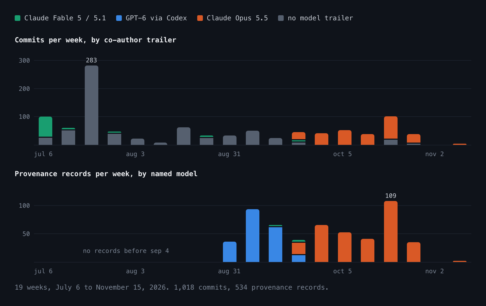

Hi, I'm Ryan. I build long-running software projects with coding agents, and most of my effort goes into the part they're worst at: knowing when the work is actually done.

The full write-ups are at [swe.gg/work](https://swe.gg/work/).

### What I'm building

| | |
|---|---|
| **Marquee** | Native media apps for iPhone, iPad, Mac, Apple TV, Android and Windows, a web client, and a Go backend that hands transcoding to GPUs on other machines. 1,018 commits in four months across three models, with a provenance record for every change since September. Private until launch, and I'm happy to share it if you ask. [How it was built](https://swe.gg/work/marquee/) |
| [**Librarry**](https://github.com/bandoracer/librarry) | A self-hosted ebook and audiobook manager, built to replace Readarr. Go, Postgres, React. |
| [**Rommio**](https://github.com/bandoracer/rommio) | Native Android and iOS apps for RomM, with libretro emulation built in. |
| [**iGhostty**](https://github.com/bandoracer/ighostty) | A macOS terminal on libghostty, with the iTerm2 features I missed. |

### How I work with agents

- Every repo has a guide written for agents, and it gets updated when one gets something wrong in a new way.
- Tasks get acceptance criteria before anyone starts.
- "Done" is graded on evidence, not on the agent saying so.
- Checks run the real thing: real GPU transcodes compared against a reference decode, real throwaway servers instead of mocks.
- Every contribution is attributed to the model or person that made it.

Marquee's history, by week and by model. The gray stretch has no model trailer on its commits.
